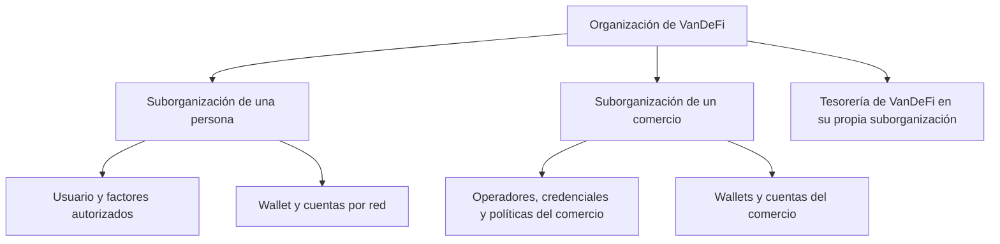

# Modelo operativo de VanDeFi

VanDeFi puede operar su propia marca, distribuir el producto a través de asociados y prestar el servicio a otras marcas. La relación comercial se registra en VanDeFi. La autorización de una operación se evalúa en el espacio de seguridad del titular en Turnkey.

## Titulares y autoridad

Una wallet admite varias cuentas y una suborganización admite varias wallets. Deben conservarse los identificadores de organización, suborganización, usuario, wallet y cuenta, además de la red y la dirección. El acceso de lectura de la organización madre permite conciliar inventario. Para autorizar una operación cuentan las credenciales válidas, las políticas y el quórum de la suborganización. El diseño utiliza un solo nivel de suborganizaciones.

## Marcas, asociados y contratos

| Modalidad | Cómo se organiza | Facultades comerciales |
| --- | --- | --- |
| Marca VanDeFi | Marca propia, con la infraestructura de la plataforma | Administra sus clientes, equipo y contratos. |
| Asociado | Una membresía por marca y contratos con atribución explícita | Consulta sus referencias y las comisiones conciliadas que le correspondan. |
| Marca blanca gestionada | Marca, dominio y permisos propios. Comparte la organización madre de la plataforma | Administra su equipo y sus reportes dentro de esa marca. |
| Marca blanca independiente | Organización madre e infraestructura dedicadas, con responsables y contrato propios | Administra su operación. El alta comercial no mueve wallets entre organizaciones. |

Un comercio es titular de su tesorería. Designa operadores con las autorizaciones que correspondan. Una marca o un asociado pueden vender el servicio sin figurar entre esos operadores. Soporte puede orientar al titular y consultar el diagnóstico autorizado. El acceso de soporte al expediente deberá quedar registrado. Una aprobación comercial de gastos o comisiones y una aprobación de firma son acciones distintas.

## Un titular desde varios dispositivos

1. El backend valida el token de identidad y resuelve emisor y sujeto contra el vínculo persistido. El correo, el nombre, la IP, el navegador y el dominio comercial son insuficientes para adjudicar una wallet.
2. El sistema localiza la suborganización del titular bajo la organización madre correcta. Una segunda marca gestionada solo puede usar una relación comercial previamente verificada y autorizada. Mostrar la misma wallet al titular no da acceso a sus saldos ni a su actividad a un administrador comercial.
3. En un dispositivo nuevo se autoriza una credencial o sesión con un factor habilitado para el usuario existente. La recuperación debe verificar el destino previamente configurado. Un cambio de navegador, sesión de Clerk o dominio nunca justifica un alta automática. Si falta un factor válido, el caso queda pendiente de conciliación.
4. La validación de aceptación requiere dos dispositivos o perfiles aislados y una cuenta dedicada y autorizada. Registrar la dirección, la red y los identificadores antes y después. Verificar que se autorice una firma de prueba y que el conteo de wallets permanezca igual. Cambiar de usuario en el mismo navegador debe invalidar el acceso al usuario anterior. Una prueba simulada no acredita este recorrido en el proveedor.

## Altas, consumo y comisiones

- Para cada alta explícita, persistir el intento antes de contactar al proveedor. Reservar tanto presupuesto de marca como presupuesto global en una transacción. Si falta cupo o un límite, bloquear el alta. Un resultado incierto conserva la reserva y exige conciliación por identificadores antes de cualquier nueva solicitud.
- Definir el evento elegible, contrato, moneda y regla de cálculo antes de devengar una comisión. Registrar el evento con identificador único y conciliarlo con la fuente antes de liquidar. Duplicados, reversos y reembolsos deben tener tratamiento auditable. Una comisión devengada no concede la capacidad de firmar un pago.
- Antes de ofrecer precios, cotejar facturación y condiciones vigentes por producto para wallets y cuentas, firmas y autenticación. Añadir por separado identidad, infraestructura, soporte y gas por red y operación.

## Alcance de esta rama

El esquema de diseño vive en `db/prototypes/platform-model.sql`, fuera de las migraciones. La prueba `tests/platform-model.test.mjs` carga PostgreSQL embebido con datos ficticios. Comprueba la separación de organizaciones y tesorerías, la resolución del mismo titular desde dos marcas gestionadas y la visibilidad de contratos con un rol SQL limitado. El backend de una implementación tendrá que autenticar el contexto de cada consulta. El SQL por sí solo no acredita quién inició sesión.

La secuencia de habilitación propuesta es validar primero continuidad y recuperación de la wallet, después asociados, luego una marca blanca gestionada y finalmente una independiente si requiere autonomía. Quedan por implementar la administración comercial, las cuotas por marca, la conciliación y liquidación de comisiones y la infraestructura dedicada por cliente. Toda prueba con factores o firmas reales requiere autorización previa del titular de prueba.

## Documentación del producto

| Pregunta | Documento de referencia | Cómo interpretarlo |
| --- | --- | --- |
| ¿Qué recorrido se diseñó para quien recibe una remesa por enlace? | [Definición de VanLink](vanlink-remittances.md) | Describe la experiencia de remitente y destinatario. La disponibilidad se valida por operación. |
| ¿Qué activo y red se eligieron para esta etapa? | [Decisión vigente ADR-009](ADR-009-usdt-polygon-unico.md) y [decisión anterior ADR-008](ADR-008-polygon-usdc-simple.md) | ADR-009 cambia el activo a USDT y conserva Polygon PoS. La habilitación requiere la prueba prevista para esa operación. |
| ¿Qué evidencia existe sobre el acceso a la wallet? | [Verificación de dispositivo y firma](QA-DEVICE-SIGNING-20261109.md) | La revisión de código tiene alcance propio. La aceptación en dos dispositivos se define arriba en este manual. |
| ¿Qué pruebas corresponden a una transferencia? | [Plan de prueba](PLAN-PRUEBA-E2E-USDT.md) y [revisión de la integración](QA-USDT-POLYGON-20261109.md) | El plan describe los pasos. El informe distingue lo ejecutado de lo pendiente. |
| ¿Dónde está la identidad de VANX? | [Identidad aprobada](vanx-brand-approved.md) | Es la referencia de marca del token. La decisión sobre el activo de transferencia se consulta en ADR-009. |

## Referencias

- [Organizaciones](https://docs.turnkey.com/features/organizations)
- [Suborganizaciones](https://docs.turnkey.com/features/sub-organizations)
- [Credencial en IndexedDB](https://docs.turnkey.com/sdks/advanced/indexed-db-stamper)
- [Sesiones](https://docs.turnkey.com/features/authentication/sessions/overview)
- [Distribución de wallets bajo marca propia](https://www.turnkey.com/embedded-wallets/embedded-waas)
